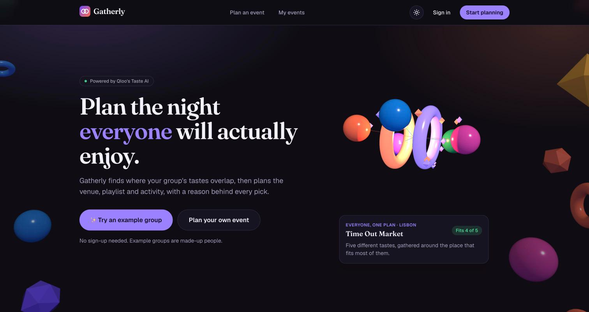
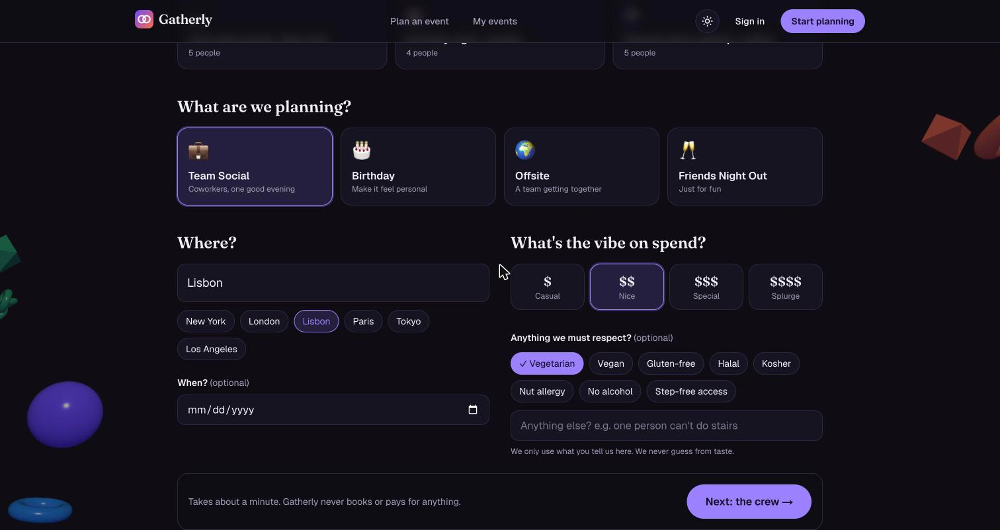
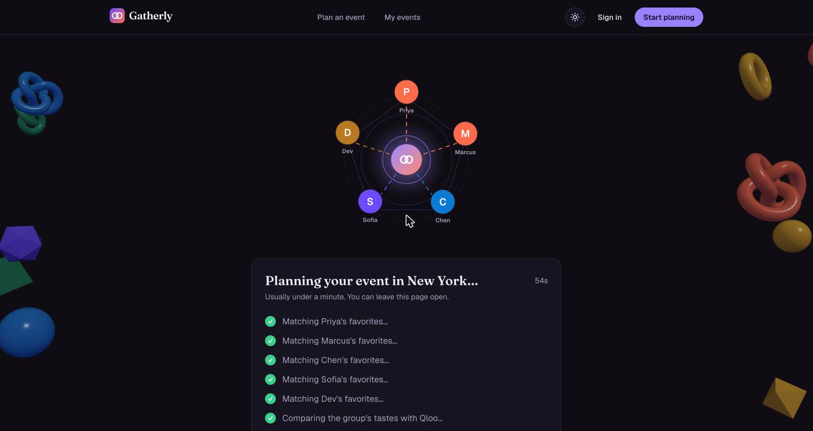
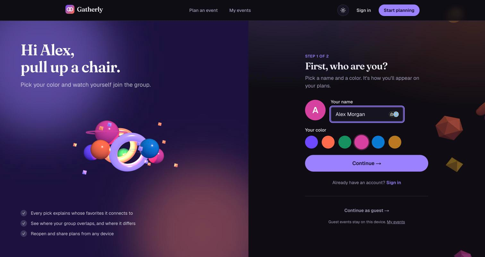
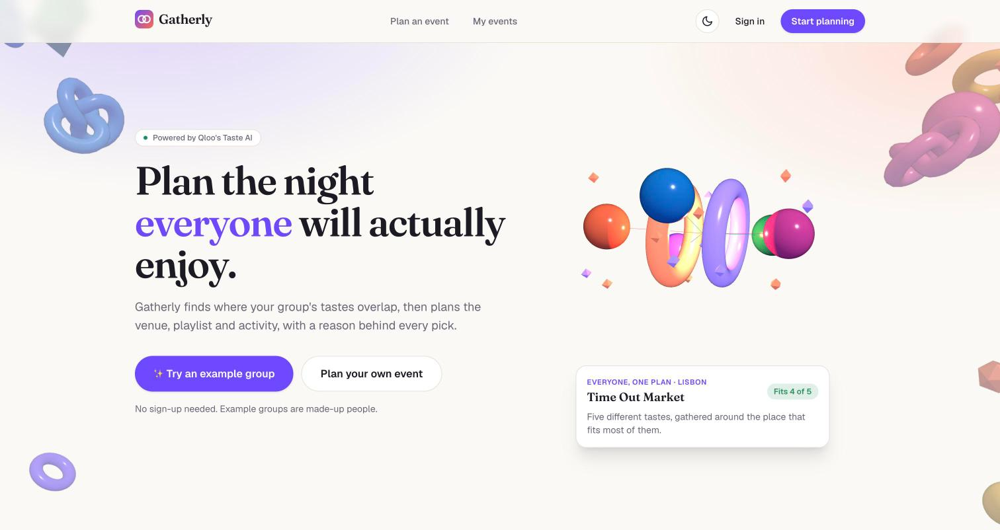
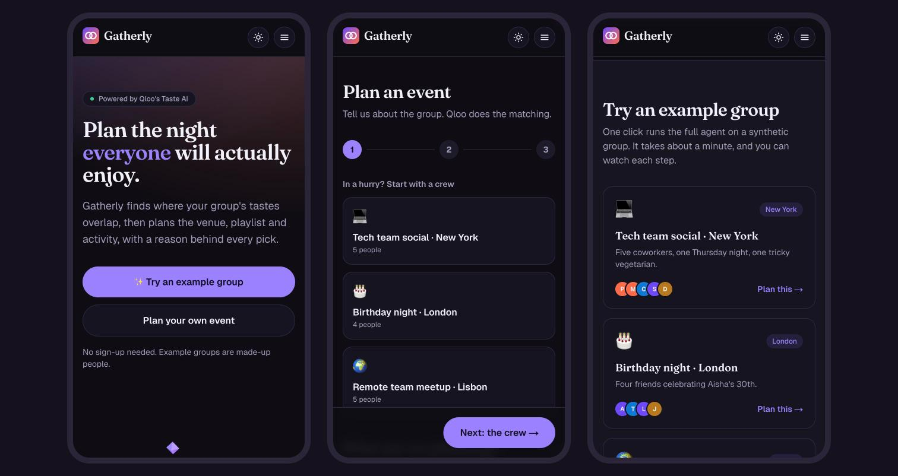
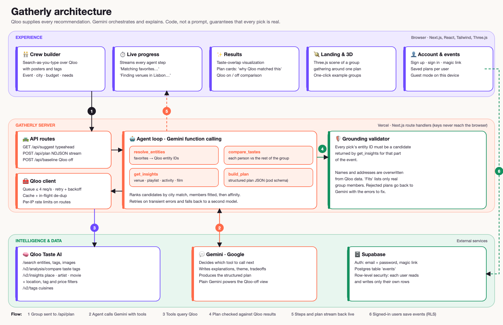
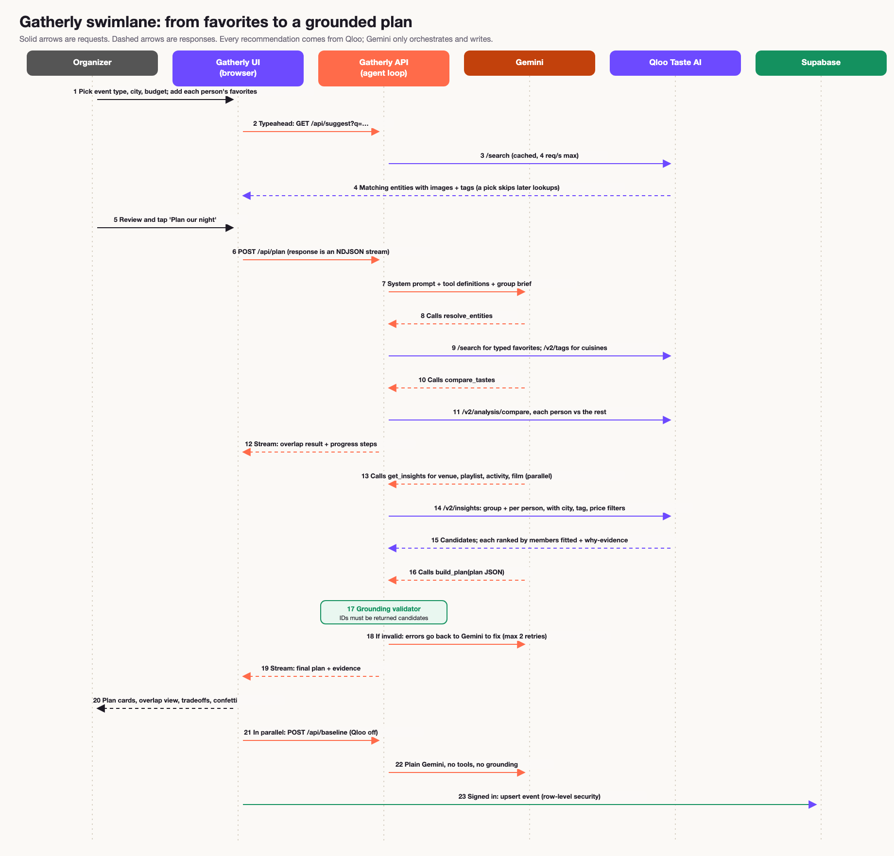
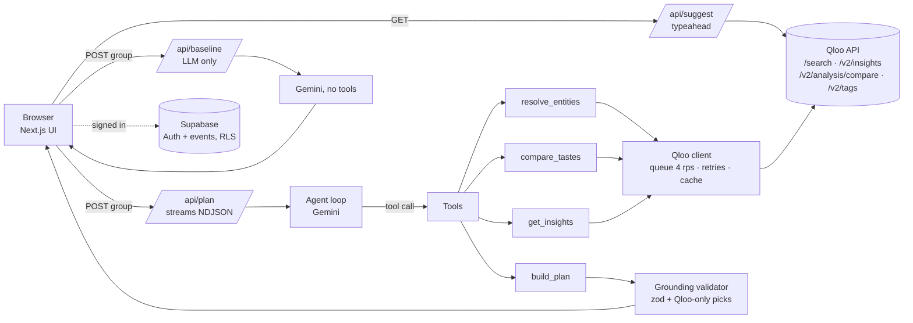

<div align="center">

# Gatherly

**An agent with taste. Plan the night everyone will actually enjoy.**

Gatherly uses [Qloo](https://qloo.com)'s taste graph to find where a group's tastes overlap, then an AI agent plans the venue, playlist, activity and film, with a reason behind every pick.

[**Live app**](https://gatherly-omega-eight.vercel.app) · [Architecture](docs/ARCHITECTURE.md) · [How Qloo is used](#how-qloo-is-used-and-why-it-beats-an-llm-alone) · [Run it locally](#run-it-locally)




</div>

Built for the Qloo Agentic Hackathon. All example people are made up.

## What it does

You describe the night (team social, birthday, offsite, friends' night out), the city, the spend level and any constraints that must be respected. You add 3–6 people and tell Gatherly what each one loves, using a search-as-you-type box over Qloo. Then the agent:

1. **Maps everyone's favorites** to Qloo entities.
2. **Measures where the group's tastes overlap and differ**: an overlap score, shared themes, each person's unique themes, and a "who clicks with whom" grid.
3. **Plans the night**: a venue and cuisine in your city, a theme, a playlist, an activity and a film.
4. **Explains every pick**: which members it fits, and the shared taste themes or favorites that connect it to each person.
5. **Flags tradeoffs** when tastes conflict, with a balanced alternative.
6. **Shows Qloo on vs. off**: the same group planned by an LLM alone, side by side.

Gatherly never books or pays for anything. Hours, prices and availability are labeled "check before booking". Dietary, accessibility and budget needs come only from what the organizer types, never from guessing.

It is a complete product: accounts (password or emailed link) with plans saved to your account, guest mode, light and dark themes, and a layout that works on phones.

## Screenshots

| | |
|---|---|
|  **1. Describe the night.** Event, city, spend and explicit constraints. |  **2. The agent at work.** Every step streams live while Qloo is queried. |
|  **3. Sign up.** Pick a color and watch yourself join the group in 3D. |  **4. Light and dark themes.** |

**On a phone:**



The results screens (taste overlap, plan cards with "Why Qloo matched this", and the Qloo on/off comparison) show live Qloo data, which Qloo's terms ask us not to store in a public repository. [Open the live app](https://gatherly-omega-eight.vercel.app) and click **Try an example group** to see them.

## Judge's guide (60 seconds)

1. Open the [live app](https://gatherly-omega-eight.vercel.app) and click **Try an example group** (New York tech team, London birthday or Lisbon remote offsite).
2. Watch the agent's steps stream in ("Matching Priya's favorites…", "Finding restaurants in New York…"). It takes about 45 seconds.
3. Read **Where your tastes meet**: overlap score, shared themes, each person's unique themes and a pairwise similarity grid.
4. Scroll the plan cards and open **Why Qloo matched this** on any pick to see the taste themes behind it.
5. Click **Qloo on / off** to see the same group planned by an LLM alone next to the Qloo plan. In our runs the LLM-only plan tended to recycle the group's own favorites and add unverifiable details, with nothing to back them up.
6. Optional: **Plan your own event** and search for anything you love. Create an account to save plans.

No login, payment or installation is needed.

## The problem

Planning for a group means negotiating taste. Someone always loses: the vegetarian, the one who hates loud bars, the person whose music never makes the playlist. Asking an LLM "what should we do?" produces generic, plausible-sounding suggestions with no data behind them, and sometimes venues that don't exist.

## How Qloo is used (and why it beats an LLM alone)

Qloo is the **only source of recommendations**. The LLM (Gemini) orchestrates and writes, but it can only recommend entities Qloo returned in that run.

| Step | Qloo endpoint | What it does |
|---|---|---|
| Typeahead and favorites | `GET /search` (`types=` per category) | Maps each typed favorite to a Qloo entity ID with images and taste tags. Food favorites that are cuisines ("ramen") fall back to `GET /v2/tags`. |
| Measure overlap | `GET /v2/analysis/compare` | Each person's entities vs. the rest of the group. Tags on both sides = shared taste; tags on one side = individual taste. Falls back to entity-level tags if compare returns nothing. |
| Venue / cuisine | `GET /v2/insights` with `filter.type=urn:entity:place`, `filter.location.query=<city>`, `filter.tags=<cuisine or restaurant tag>`, `filter.price_level.max=<budget>` | Restaurants in the chosen city, seeded by the group's entities. |
| Activity | `GET /v2/insights` (places, restaurants excluded via `filter.exclude.tags`) | Non-dining things to do in the city. |
| Playlist | `GET /v2/insights` with `filter.type=urn:entity:artist` | New artists connected to the group's taste. |
| Film | `GET /v2/insights` with `filter.type=urn:entity:movie` | Films connected to the group's taste. |

The legacy `/recs` and `/recommendations` endpoints are not used.

**Ranking by how many members a pick fits.** For each part of the event we call insights once for the whole group *and* once per person. A candidate "fits" a person if it appears in that person's results. Picks are ranked by city match, then fit count, then Qloo affinity. This is real Qloo data, not a model's guess.

**Why it is better than an LLM alone**

- **Grounded:** a validator ([`grounding.ts`](src/lib/agent/grounding.ts)) rejects any plan whose picks were not returned by Qloo for the right part of the event. Names and addresses are overwritten from Qloo data, so the model cannot alter them.
- **Discovery:** Qloo recommends artists and places the group hasn't mentioned but would like. The LLM-only baseline mostly repeats the group's own favorites.
- **Location-aware:** venues come from Qloo's locality-aware place graph, and a live test checks that the city filter is honored (Qloo silently ignores unsupported parameters, so we verify).
- **Explainable:** each pick shows the favorites or shared taste themes that produced it.

### Honesty rules built into the agent

- Never invents venues, artists or films.
- Dietary needs, accessibility and budget are **explicit user inputs only**, never inferred from taste.
- No claims about opening hours, prices or availability: the UI labels these "check before booking".
- Gatherly never books or pays for anything.

## Architecture



The swimlane below follows one plan from the organizer's first click to a grounded, streamed result. More detail is in [docs/ARCHITECTURE.md](docs/ARCHITECTURE.md).



<details>
<summary>The same flow as a Mermaid diagram</summary>



</details>

**Key pieces**

- **Qloo client** ([`src/lib/qloo/client.ts`](src/lib/qloo/client.ts)): request queue (max 4 starts per second), per-request timeout, exponential backoff on 429/5xx honoring `Retry-After`, in-memory cache and in-flight de-duplication. The API key is only ever used server-side.
- **Agent** ([`src/lib/agent/`](src/lib/agent)): Gemini function-calling loop with four tools (`resolve_entities`, `compare_tastes`, `get_insights`, `build_plan`). Progress events stream to the UI as the tools run. Gemini calls retry on transient errors and fall back to a second model.
- **Plan JSON** is validated with zod ([`src/lib/schemas.ts`](src/lib/schemas.ts)) and grounded before the UI sees it.
- **Accounts** use Supabase Auth (email and password, magic link, optional Google). Signed-in users' events are saved to a Postgres `events` table protected by row-level security ([`supabase/schema.sql`](supabase/schema.sql)). Guests can still plan; their events stay in the browser.
- **UI**: Next.js (App Router), TypeScript and Tailwind, with a Three.js scene on the landing and sign-in pages (2D fallback, and off for reduced motion).

## Run it locally

Requirements: Node 20+, a Qloo hackathon API key, and a Gemini API key (Google AI Studio) or a Google Cloud project with Vertex AI.

```bash
git clone https://github.com/codergirl73/gatherly && cd gatherly
npm install
cp .env.example .env.local   # then fill it in
npm run dev                  # http://localhost:3000
```

Environment variables (see [`.env.example`](.env.example)):

| Variable | Purpose |
|---|---|
| `QLOO_API_KEY` | Qloo hackathon key. Works only against `https://hackathon.api.qloo.com`. |
| `GEMINI_API_KEY` | Simplest option: a Gemini API key from Google AI Studio. If set, the Vertex AI settings are ignored. |
| `GEMINI_MODEL` | Model id (default `gemini-3.5-flash`). |
| `GEMINI_FALLBACK_MODEL` | Optional. Used after two transient failures (default `gemini-3.1-flash-lite`). |
| `GOOGLE_CLOUD_PROJECT`, `GOOGLE_CLOUD_LOCATION` | Vertex AI option: project and region (default `us-central1`). Locally, sign in with `gcloud auth application-default login`. |
| `GOOGLE_SERVICE_ACCOUNT_JSON_B64` | Hosted Vertex AI only: base64 of a service-account JSON with the *Vertex AI User* role. |
| `NEXT_PUBLIC_SUPABASE_URL`, `NEXT_PUBLIC_SUPABASE_ANON_KEY` | Supabase project for accounts and saved events. Blank = guest mode. |
| `NEXT_PUBLIC_AUTH_GOOGLE` | Set to `1` once the Google provider is enabled in Supabase. |

### Accounts (Supabase)

1. Create a project at supabase.com. In **SQL Editor**, run [`supabase/schema.sql`](supabase/schema.sql).
2. **Authentication → URL Configuration**: set *Site URL* to your deployed URL and add `http://localhost:3000/**` and your deployed URL `/**` to *Redirect URLs*.
3. Copy the project URL and public key (**Project Settings → API Keys**) into `.env.local` or your Vercel environment variables.
4. Optional: turn off *Confirm email* (Authentication → Sign In / Providers → Email) so sign-up logs people straight in, and enable the Google provider with `NEXT_PUBLIC_AUTH_GOOGLE=1`.

## Tests and checks

```bash
npm test             # unit tests: Qloo client (mocked), overlap, plan validation + grounding, evidence, Gemini retries
npm run test:live    # integration: runs against the live Qloo API (needs QLOO_API_KEY)
npm run typecheck && npm run lint
npm run qloo:smoke   # prints raw /search and /v2/insights output for your key
npx tsx --env-file=.env.local scripts/run-preset.mts lisbon-remote   # full agent run in the terminal
```

The live suite checks that `/search` resolves entities, that place results for Lisbon, London and New York are really in those cities, that different cities give different results (the filter isn't silently ignored), that the tag filter changes results, and that a preset group yields in-city venue and activity candidates.

## Deploy to Vercel

1. Import the repo in Vercel (framework: Next.js).
2. Add the environment variables above (at minimum `QLOO_API_KEY`, `GEMINI_API_KEY`, `GEMINI_MODEL`, and the two Supabase values if you want accounts).
3. Deploy. A plan usually takes 40–60 seconds. The plan route sets `maxDuration = 300`, so check your Vercel plan's function-timeout limit; on a 60-second limit, lower `maxTurns` in [`src/lib/agent/loop.ts`](src/lib/agent/loop.ts).

## Limitations

- Qloo's locality boundary is slightly expanded, so a few results can sit just outside the city. They are ranked below in-city matches.
- Qloo returns no live hours, prices or availability. Gatherly says so and never books anything.
- Dietary and accessibility constraints are echoed and flagged for confirmation with the venue. Qloo doesn't verify them.
- The overlap score measures taste-tag similarity, not predicted enjoyment.
- Per-IP rate limiting is in memory (per server instance), and the Qloo cache resets on cold starts.
- Entity matching for typed favorites is by name search, so ambiguous names can match the wrong entity. Picking from the search suggestions avoids this, and Gatherly warns when a typed match looks uncertain.
- Qloo response data is cached privately in server memory only and is never stored in this repository.

## License

MIT. See [LICENSE](LICENSE).
