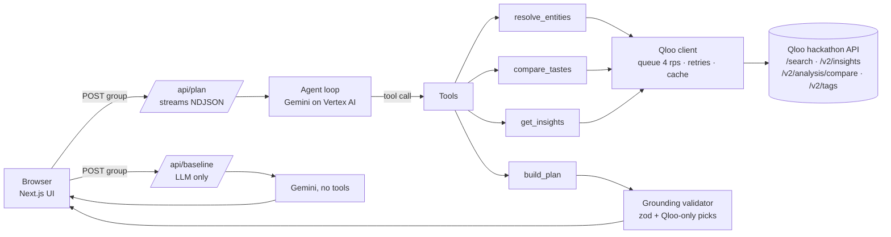

# Gatherly

**An AI agent that plans group events everyone will enjoy, powered by [Qloo](https://qloo.com)'s Taste AI.**

> Live app: _add the Vercel URL here after deploy_

Gatherly takes a group of 3–6 people (each sharing a few favorite films, shows, artists, restaurants, places, brands or books), finds where their tastes overlap and where they differ, and plans the event: **venue and cuisine, a theme, a playlist, an activity and a film**. Every pick explains *whose favorites it connects to*. When tastes clash, Gatherly flags the tradeoff and offers a balanced alternative.

Built for the Qloo Agentic Hackathon. All example people are synthetic.

## Judge's guide (60 seconds)

1. Open the live app and click **Try an example group** (or pick a preset card: New York tech team, London birthday, Lisbon remote offsite).
2. Watch the agent's steps stream in ("Matching Priya's favorites…", "Finding restaurants in New York…"). It takes about 40–60 seconds.
3. Read the **taste overlap** section: group overlap score, themes shared by the group, each person's unique themes and a pairwise similarity grid.
4. Scroll the plan cards. Open **"Why Qloo matched this"** on any pick to see the favorites and tags behind it.
5. Click **Qloo on / off** to see the same group planned by an LLM alone, next to the Qloo plan. In our runs the LLM-only plan tended to recycle the group's own favorites and add unverifiable details, with nothing to back them up.
6. Optional: **Plan your own event** to enter any group, city, budget and constraints.

## The problem

Planning for a group means negotiating taste. Someone always loses: the vegetarian, the one who hates loud bars, the person whose music never makes the playlist. Asking an LLM "what should we do?" produces generic, plausible-sounding suggestions with no data behind them, and sometimes venues that don't exist.

## How Qloo is used (and why it beats an LLM alone)

Qloo is the **only source of recommendations**. The LLM (Gemini) orchestrates and writes, but it can only recommend entities Qloo returned in that run.

| Step | Qloo endpoint | What it does |
|---|---|---|
| Resolve favorites | `GET /search` (`types=` per category) | Maps each typed favorite to a Qloo entity ID plus its taste tags. Food favorites that are cuisines ("ramen") fall back to `GET /v2/tags`. |
| Measure overlap | `GET /v2/analysis/compare` | Each person's entities vs. the rest of the group. Tags present on both sides = shared taste; tags only on one side = individual taste. Falls back to entity-level tags if compare returns nothing. |
| Venue / cuisine | `GET /v2/insights` with `filter.type=urn:entity:place`, `filter.location.query=<city>`, `filter.tags=<cuisine or restaurant tag>`, `filter.price_level.max=<budget>` | Restaurants in the chosen city, seeded by the group's entities. |
| Activity | `GET /v2/insights` (places, restaurants excluded via `filter.exclude.tags`) | Non-dining things to do in the city. |
| Playlist | `GET /v2/insights` with `filter.type=urn:entity:artist` | New artists connected to the group's taste. |
| Film | `GET /v2/insights` with `filter.type=urn:entity:movie` | Films connected to the group's taste. |

The legacy `/recs` and `/recommendations` endpoints are not used.

**Ranking by how many members a pick fits.** For each part of the event we call insights once for the whole group *and* once per person. A candidate "fits" a person if it appears in that person's results. Picks are ranked by city match, then fit count, then Qloo affinity. This is real Qloo data, not a model's guess.

**Why it is better than an LLM alone**

- *Grounded:* a validator (`src/lib/agent/grounding.ts`) rejects any plan whose picks were not returned by Qloo for the right part of the event. Names and addresses are overwritten from Qloo data, so the model cannot alter them.
- *Discovery:* Qloo recommends artists and places the group hasn't mentioned but would like. The LLM-only baseline mostly repeats the group's own favorites.
- *Location-aware:* venues come from Qloo's locality-aware place graph, and a live test checks the city filter is honored (Qloo silently ignores unsupported parameters, so we verify).
- *Explainable:* each pick links to the specific favorites and shared tags that produced it.

### Honesty rules baked into the agent

- Never invents venues, artists or films.
- Dietary needs, accessibility and budget are **explicit user inputs only**, never inferred from taste.
- No claims about opening hours, prices or availability: the UI labels these "check before booking".
- Gatherly never books or pays for anything.

## Architecture



- **Tech:** Next.js (App Router) + TypeScript + Tailwind, zod, Vitest. No database; state lives in the browser, and the server caches Qloo responses in memory.
- **Qloo client** (`src/lib/qloo/client.ts`): request queue (max 4 starts/second), per-request timeout, exponential backoff on 429/5xx honoring `Retry-After`, in-memory cache plus in-flight de-duplication. The API key is only ever used server-side.
- **Agent** (`src/lib/agent/`): Gemini function-calling loop with four tools (`resolve_entities`, `compare_tastes`, `get_insights`, `build_plan`). Progress events stream to the UI as the tools run.
- **Plan JSON** is validated with zod (`src/lib/schemas.ts`) and grounded before the UI sees it.
- **Accounts** use Supabase Auth (email + password, optional Google). Signed-in users' events are saved to a Postgres `events` table protected by row-level security (`supabase/schema.sql`). Guests can still plan; their events stay in the browser.

## Setup

Requirements: Node 20+, a Qloo hackathon API key, and a Google Cloud project with Vertex AI enabled.

```bash
git clone <this repo> && cd gatherly
npm install
cp .env.example .env.local   # then fill it in
gcloud auth application-default login   # local Gemini auth (no key file needed)
npm run dev                  # http://localhost:3000
```

Environment variables (see `.env.example`):

| Variable | Purpose |
|---|---|
| `QLOO_API_KEY` | Qloo hackathon key. Works only against `https://hackathon.api.qloo.com`. |
| `GOOGLE_CLOUD_PROJECT` | GCP project with Vertex AI. |
| `GOOGLE_CLOUD_LOCATION` | Vertex region (default `us-central1`). |
| `GEMINI_MODEL` | Model id (default `gemini-2.5-flash`). |
| `NEXT_PUBLIC_SUPABASE_URL`, `NEXT_PUBLIC_SUPABASE_ANON_KEY` | Supabase project for accounts and saved events. Blank = guest mode. |
| `NEXT_PUBLIC_AUTH_GOOGLE` | Set to `1` once the Google provider is enabled in Supabase. |
| `GOOGLE_SERVICE_ACCOUNT_JSON_B64` | Hosted deploys only: base64 of a service-account JSON with the *Vertex AI User* role. |

### Accounts (Supabase)

1. Create a project at supabase.com. In **SQL Editor**, run `supabase/schema.sql`.
2. **Authentication → URL Configuration**: set *Site URL* to your deployed URL and add `http://localhost:3000/**` and your deployed URL `/**` to *Redirect URLs*.
3. Copy the project URL and anon key (**Project Settings → API**) into `.env.local` / Vercel env vars.
4. Optional: enable the Google provider and set `NEXT_PUBLIC_AUTH_GOOGLE=1`.

## Tests and checks

```bash
npm test             # unit tests: Qloo client (mocked), overlap logic, plan validation + grounding
npm run test:live    # integration: runs a preset against the live Qloo API (needs QLOO_API_KEY)
npm run typecheck && npm run lint
npm run qloo:smoke   # prints raw /search and /v2/insights output for your key
npx tsx --env-file=.env.local scripts/run-preset.mts lisbon-remote   # full agent run in the terminal
```

The live suite checks that `/search` resolves entities, that place results for Lisbon, London and New York are really in those cities, that different cities give different results (the filter isn't silently ignored), and that a preset group yields in-city venue and activity candidates.

## Deploy to Vercel

1. Import the repo in Vercel (framework: Next.js).
2. Add the environment variables above. For `GOOGLE_SERVICE_ACCOUNT_JSON_B64`, create a service account with the *Vertex AI User* role, download its JSON key, and run `base64 -i key.json | tr -d '\n'`.
3. Deploy. A plan usually takes 40–60 s. The plan route sets `maxDuration = 300`, so enable Fluid Compute and check your plan's function-timeout limit in Vercel's project settings; on a 60 s limit, lower `maxTurns` in `src/lib/agent/loop.ts`.

## Limitations

- Qloo's locality boundary is slightly expanded, so a few results can sit just outside the city. They are ranked below in-city matches.
- Qloo returns no live hours, prices or availability. Gatherly says so and never books anything.
- Dietary and accessibility constraints are echoed and flagged for confirmation with the venue. Qloo doesn't verify them.
- The overlap score is a measure of tag similarity, not a prediction of enjoyment.
- Per-IP rate limiting is in-memory (per server instance), and the Qloo cache resets on cold starts.
- Entity matching is by name search: ambiguous names may match the wrong entity. Gatherly surfaces a warning when the match looks uncertain.
- Qloo response data is cached privately in server memory only and is never stored in this repository.

## License

MIT. See [LICENSE](LICENSE).
